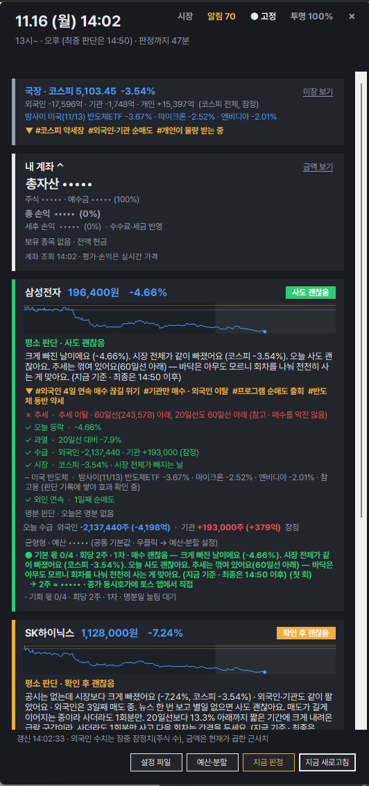
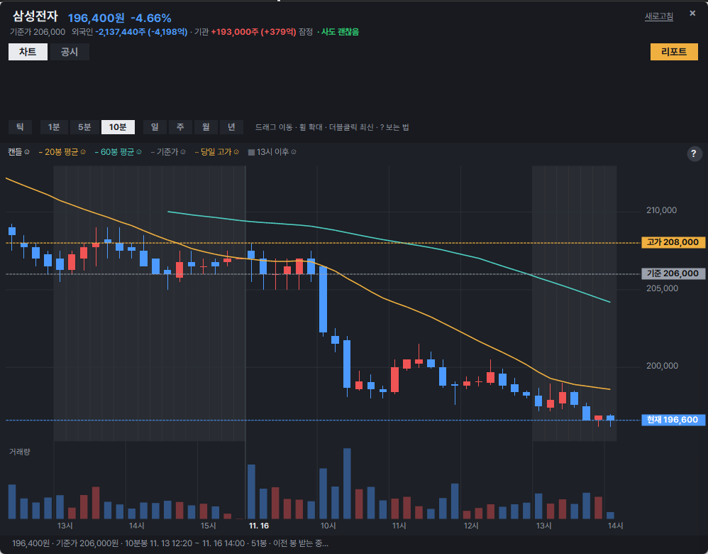

# 용머리 알리미 (DragonHead)

삼성전자·SK하이닉스 시세를 감시하다가, 미리 정한 매수 조건이 되면 화면 오른쪽 아래에 알림을 띄우는 Windows 트레이 앱입니다.

<p>
  
  
</p>

*왼쪽: 상황판 (시장 요약, 종목별 판정과 근거, 금액 숨기기 적용) · 오른쪽: 차트 창 (10분봉, 이동평균선, 기준가)*

## 만든 목적

반도체 종목을 분할 매수하면서, 장중에 증권 앱을 계속 들여다보지 않고도 **정해 둔 규칙에 맞는 순간만** 알림으로 받고 싶어서 만들었습니다.
매수 판단은 사람이 하고, 앱은 시세·수급·공시 일정을 모아 "지금이 규칙상 살 타이밍인지"만 알려 줍니다.

## 주요 기능

- **매수 타이밍 알림**: 실적 공시·IR 같은 명분일에 주가가 기준가 아래인지 등을 판정해 단계별로 알림
- **상황판**: 종목별 현재가·등락·외국인/기관 수급, 내 계좌 요약, 차트
- **예산·분할 매수 관리**: 종목별 예산을 기본 몫과 기회 몫으로 나눠 회차별 매수 수량 안내
- **공시 자동 연동**: DART에서 실적 공시·IR 일정을 받아 명분일 자동 등록
- **백테스트**: 과거 데이터로 판정 규칙 비교 (현재 규칙도 백테스트 결과로 정함)

## 설계 원칙

- **조회 전용**: 토스증권 Open API를 시세·잔고 조회에만 사용하고, 주문 기능은 넣지 않았습니다.
- **키는 코드에 없음**: API 키는 앱 설정 화면에서 입력받아 Windows DPAPI로 암호화한 뒤 `%APPDATA%\DragonHead`에 저장합니다.

## 기술 스택

| 영역 | 사용 |
| --- | --- |
| 언어 / 런타임 | C# · .NET 8 |
| UI | WinForms |
| 외부 API | 토스증권 Open API (조회), DART Open API (공시) |
| 보안 | Windows DPAPI |

## 구조

```
src/DragonHead.Core      API 클라이언트, 판정 엔진, 분할 매수 계산, 백테스터
src/DragonHead.App       트레이 아이콘, 알림, 상황판·차트 (WinForms)
tests/DragonHead.Checks  판정 엔진 시나리오 점검
```

## 실행

```powershell
powershell -ExecutionPolicy Bypass -File .\publish.ps1   # 빌드 후 실행
dotnet run --project tests/DragonHead.Checks             # 판정 엔진 점검
```

처음 실행하면 토스증권 API 키 입력 창이 뜹니다.

> 이 앱은 개인 투자 보조용이며, 알림은 투자 권유가 아닙니다.

---

# 사용 설명서

## 판정 규칙 (2026-10 백테스트로 변경)

삼성·하이닉스 5년, 명분일 51일 백테스트에서 **명분일에 오른 날 산 것보다 하락 마감한 날 산 쪽이** 앞·뒤 기간 모두 기준선(아무 날)보다 좋았습니다.
그래서 예전 '용의 머리'(상승 + 고점 부근 + 외국인 연속) 대신 아래 규칙으로 판정합니다. 예전 규칙은 백테스트 비교용으로만 남아 있습니다.

| 판정 | 조건 | 색 |
|---|---|---|
| **눌림 매수** | 명분일, 14:50 이후 현재가가 기준가(전일 종가) 아래 → 1차 분할(1/4) 후보 | 초록 |
| └ 강한 후보 | 위 + 외국인·기관 동반 순매도 **또는** 거래량 20일 평균 1.5배 이상 (`StrongVolumeRatio`) | 초록 |
| **눌림 후보** | 명분일, 10:00~14:50 기준가 아래. 종가까지 지켜봄 | 파랑 |
| **추격 금지** | 명분일인데 기준가 위 (수급·거래량이 좋아도) | 주황 |
| **쇼크 의심** | 명분일 -5% 이하(`ShockDropPct`)인데 코스피는 보합·상승 → 공시 확인 후 판단 | 빨강 |
| **갭상승 경계** | 09~10시 시초가 +1.5% 이상 (정보용) | 빨강 |
| **약세 경계** | 명분 없는 날, -2% 이상 하락 + 외국인 매도 + (기관 매도 또는 외국인 2일 연속 매도). 참고용 — 신규 매수 대상은 아니고 기본 몫 일정은 그대로 | 보라 |
| **관망** | 명분 없는 날 등 | 회색 |

외국인 연속 순매수는 판정에서 뺐고(성과를 높이지 못함) 체크리스트에 참고로만 나옵니다. 명분일에는 '회피'를 적용하지 않습니다 (동반 매도로 빠진 명분일이 오히려 좋았음).

## 판단 두 가지

| | **명분 판단** (기회 몫) | **평소 판단** (기본 몫) |
|---|---|---|
| 언제 | 명분일 (실적 공시·실적 IR) | 명분 없는 날 매일 10시 이후 |
| 보는 것 | 기준가 아래 · 쇼크 아님 · 강도(동반 매도 / 거래량 1.5배) | 추세(20·60일선) · 오늘 등락 · 과열(20일선 +5%) · 수급(외국인·기관) · 시장(코스피) |
| 결과 | 눌림 매수 / 눌림 후보 / 추격 금지 / 쇼크 의심 | **사도 괜찮음**(하락·보합 마감) / **확인 후 괜찮음**(공시 없는데 혼자 크게 빠지거나 동반 매도 → 뉴스 보고 별일 없으면) / **기다려 봄**(오른 날·+2% 급등·20일선 +5% 과열 → 며칠 안에 하락 마감일을 기다리고, 매수 창 마지막 날엔 삼). 추세 이탈(60일선 아래)은 주의 문구만 붙고 매수를 막지 않음 |

카드 배지는 명분일엔 명분 판단, 아닌 날엔 평소 판단입니다. 기본 몫은 지난 기본 몫 매수 뒤 최소 간격(`CoreIntervalDays`, 기본 5거래일)이 지나면 매수 창(`CoreWindowDays`, 기본 5거래일)이 열리고, 그 안에서 평소 판단이 괜찮은 날 또는 창 마지막 날 '매수 차례'가 됩니다.
백테스트상 한 주 안에서 언제 사느냐는 매수가 차이가 ±0.5% 안팎으로 작았고, 두 기간 모두 조금이라도 싸게 산 건 '첫 하락 마감일'뿐이라 이렇게 정했습니다.
**외국인 연속 매도**: 외국인이 3거래일 이상 연속 순매도 중이면 하락일이어도 평소 판단은 '기다려 봄'입니다(창 마지막 날엔 1회분 삼). 백테스트 S표 최근 기간에서 3일째 매도 중(S1)은 기준선보다 -3.6%p, 5일째(S2)는 -5.5%p였습니다(앞 기간엔 둘 다 +0.8%p 안팎). 3일 이상 매도가 끝나고 순매수로 돌아선 날은 문구로 알려 줍니다. 하루짜리 동반 매도는 그대로 '사도 괜찮음'입니다.

백테스트의 **기본 몫 타이밍** 표(T0~T9)에서 '정해진 날 바로 사기'와 평소 판단 규칙(T8·T9) 등을 매수가로 비교합니다.

## 예산 · 분할 (트레이 메뉴 **예산 · 분할 설정**)

종목별 예산을 **기본 몫**(명분과 상관없이 정해진 간격으로 정기 분할)과 **기회 몫**(명분일 눌림에서만)으로 나눕니다.
백테스트에서 명분 없는 날은 언제 사도 결과가 비슷했고, 명분일 눌림은 기준선보다 좋았기 때문입니다.

| 프리셋 | 기본 / 기회 | 오를 때 | 빠질 때 | 맞는 사람 |
|---|---|---|---|---|
| 수비형 | 25 / 75 | 많이 놓침 | 현금이 많아 덜 아픔 | 물리는 게 제일 싫은 사람 |
| 균형형 (기본값) | 50 / 50 | 절반은 따라감 | 절반만 노출 | 아직 잘 모르겠는 사람 |
| 공격형 | 75 / 25 | 거의 따라감 | 거의 다 맞음 | 반도체 장기 상승을 믿는 사람 |

- 직접 설정: 기본 몫 비율(0~100%, 5% 단위), 기본 몫 간격(1주 / 2주 / 한 달), 회차 수(각 1~10).
- 종목별 예산: 0이면 그 종목은 매수 안내를 하지 않습니다. 설정 파일에서는 `Watch[].Budget`, `Strategy.CoreRatio`, `CoreIntervalDays`, `CoreTranches`, `OppTranches`.
- 과거 매수는 그날이 명분일이면 기회 몫, 아니면 기본 몫으로 셉니다. 체결 내역이 없으면 매입금액으로 기본 몫 회차를 추정합니다.
- 기본 몫은 명분일에 오른 날(추격 금지)·쇼크 의심일에는 하루 미룹니다. 3일 연속 하락한 날이면 '조금 나은 날'로 표시합니다 (백테스트에서 두 기간 모두 약간 나았던 유일한 조건).
- 15:15 알림: 살 차례인 몫(기회 몫 우선)과 1회분·수량. 카드와 리포트에 두 몫의 진행이 같이 나옵니다.

## 언제 뭐가 뜨나

| 시각 / 상황 | 알림 | 색 |
|---|---|---|
| 08:55 | 오늘의 브레이크. 오늘 등록된 명분 유무 | 주황 |
| 09~10시, 시초가 +1.5% 이상 | 갭상승 경계 | 빨강 |
| 명분일에 기준가 위 | 추격 금지 (종목당 하루 1번) | 주황 |
| 명분일 장중 기준가 아래 | 눌림 후보 | 파랑 |
| 눌림 후보 후 기준가 위로 1분 이상 | 눌림 후보 해제 | 주황 |
| 명분일 혼자 급락 | 쇼크 의심 (클릭할 때까지 유지) | 빨강 |
| 10:00~14:30, 30분마다 | **중간 점검**: 종목별 현재가·등락·외국인/기관 잠정 수급·고가 대비·태그 (설정 `Notify.CheckEveryMinutes`, `CheckFrom`, `CheckTo`, 0이면 끔) | 판정색 |
| 14:50 | 종목별 판정 요약 | 판정색 |
| 15:15 | 눌림 매수면 "1차 분할 후보"(설정 예산 기준 수량 참고, 클릭할 때까지 유지). 보유 중이면 2~4차 안내. 없으면 "오늘은 진입 없음" | 초록 / 회색 |

**지금 판정** (상황판 아래 버튼): 데이터를 새로 받아 그 시점 기준 종목별 판정·미충족 조건·태그를 알림으로 보여줍니다.

트레이 아이콘 색도 가장 중요한 판정 색으로 바뀝니다. 아이콘을 클릭하면 상황판이 열립니다.

**알림 기록**: 뜬 알림은 전부 `alerts.json`에 최근 7일·300건까지 남습니다. 상황판 상단의 **알림 N**(안 읽은 개수, 주황)이나 트레이 메뉴 **알림 기록**으로 열고, 날짜별로 최신순으로 보입니다. 창을 열면 읽음 처리됩니다.

상황판 창: 위쪽 아무 데나 끌어서 이동, 가장자리를 끌어서 크기 조절. 오른쪽 위 **● 고정**(항상 위), **투명도**(클릭하면 슬라이더 40~100%, 마우스 휠로 5%씩), **×**(닫기 — 앱은 트레이에서 계속 실행).
다른 창을 눌러도 닫히지 않습니다. 위치·크기·고정·투명도는 `%APPDATA%\DragonHead\window.json`에 자동 저장됩니다.

상황판 맨 위 **내 계좌** 카드: 총자산, 주식·예수금, 총 손익과 오늘 손익(금액·%), 보유 종목별 평가금액·수익률·비중.
수익은 빨강, 손실은 파랑. 달러 종목은 토스 매매기준율로 원화 환산해 비중을 계산합니다.
카드의 **금액 숨기기**를 누르면 금액만 가려지고 %는 남습니다. 기본값을 숨김으로 하려면 `settings.json`에 `"HideAmounts": true`.
장중 현재가는 상황판이 열려 있으면 1초, 닫혀 있으면 5초마다 갱신합니다 (분봉 1분, 수급 5분). 같은 알림은 종목당 하루 1번만 뜹니다.
계좌는 장중 5분, 그 외 30분마다 갱신되며 [지금 새로고침]을 누르면 바로 다시 조회합니다.

## 차트 · 리포트

- **카드 미니 차트**: 오늘 1분봉. 회색 점선 = 기준가, 노란 점선 = 당일 고가, 옅은 음영 = 13시 이후(오후 지지 구간).
- **종목 창** (카드나 시장 창의 줄을 누르면): **차트 / 공시** 탭 + **리포트** 버튼.
  - 차트: **틱 · 1분 · 5분 · 10분 · 일 · 주 · 월 · 년** 캔들 (20·60 이동평균, 거래량, 기준가·평단 점선, ▲ 매수일, ◆ 명분일, 분봉은 13시 이후 음영·당일 고가).
    - **드래그**로 좌우 이동, **휠**로 확대·축소(커서 위치 기준), **더블클릭**으로 최신 화면. 키보드 ←→(이동) ↑↓(확대).
    - 왼쪽 끝까지 끌면 이전 봉을 자동으로 더 받아 붙입니다. 처음에는 일봉 약 2년 반, 월봉은 약 10년, 년봉은 받을 수 있는 만큼.
    - 토스 API는 1분봉·일봉만 주므로 5·10분봉은 1분봉을, 주·월·년봉은 일봉을 합쳐서 만듭니다. 분봉은 정규장(09:00~15:30)만 그립니다.
    - **틱**: 체결 10건 = 봉 하나. 토스 API는 최근 체결 50건만 주고 과거·실시간 스트림(웹소켓)이 없어서, 틱 차트를 보는 동안 1초마다 받아 이어 붙입니다. 창을 연 시점부터 쌓이고, 1초에 50건 넘게 몰리면 일부가 빠집니다(상태줄에 표시).
    - 창 가장자리를 끌어 크기를 바꾸면 다음에도 그 크기, 마지막에 고른 봉 단위도 기억합니다.
  - 마우스를 올리면 그날 시가·고가·저가·종가·거래량. 선·점선·범례(ⓘ)에 올리면 그게 뭔지·어떻게 보는지 설명.
  - 오른쪽 위 **?** : 이 차트에서 중점으로 볼 것.
- **리포트**: 맨 위 **주가 기록**은 1·5·10분·일·주·월·년 탭이 있는 대화형 차트 (마우스를 올리면 그 봉의 시가·고가·저가·종가·거래량, 드래그 이동, 휠 확대, 더블클릭 처음으로). 그 아래 판정·체크리스트(각 조건 설명), 일봉·1분봉 차트, 추세 지표(20/60일선 거리, 기울기, 수익률, 고점 대비, 변동폭, 거래량), 수급 10일 표, 보유·분할 매수, 명분일과 그 뒤 반응, 주요 공시, 시장 분위기, 용어 풀이. `%APPDATA%\DragonHead\reports\종목-날짜.html`로 저장하고 브라우저로 엽니다. 차트 요소에 마우스를 올리면 설명이 뜹니다.

## API 키 설정

처음 실행하거나 키가 비어 있으면 입력 창이 뜹니다. 토스 Client ID·Secret, DART 인증키(선택)를 넣고 **연결 확인**으로 시험한 뒤 **저장**하면 설정 파일에 들어가고(Secret 은 암호화) 바로 시작합니다. 나중에 바꾸려면 트레이 메뉴 **API 키 설정** — 저장하면 앱이 새 키로 다시 시작합니다.

## 분할 매수 (2~4차)

보유 중인 감시 종목은 카드에 **분할 매수 1/4 · 마지막 매수 10/28 (5거래일 전)** 과 다음 회차 상태가 나옵니다.

- 회차: 토스 체결 내역(최근 1년, 조회만)에서 이번 보유 구간의 매수일 수를 셉니다. 같은 날 여러 번 체결은 1회, 전량 매도하면 다시 0부터. 내역이 없으면 매입금액 ÷ 1회분(100만 원)으로 추정합니다.
- 다음 회차 가능 조건 (지침 3단계: 1~2주 간격, 우상향 유지 또는 건전한 조정):
  1. 마지막 매수 후 **5거래일 이상**
  2. **추세 유지**(현재가가 20일선 위, 20일선 상승) 또는 **건전한 조정**(20일선 아래지만 60일선 위, 20일 고점 대비 -3~-10%)
  3. 오늘 **회피** 판정이 아님
- 가능하면 15:15에 **N차 추가 매수 구간** 알림(수량 포함). 14:50 요약과 '지금 판정'에도 상태가 같이 나옵니다.
- 이미 보유 중인 종목이 용의 머리여도 '1차 정찰병'은 안내하지 않고 분할 매수 상태로 안내합니다.

## 빌드

```powershell
.\publish.ps1
```
실행 중인 앱 종료 → `publish\DragonHead.exe` 빌드 → 다시 실행. 스크립트 실행이 막히면 `powershell -ExecutionPolicy Bypass -File .\publish.ps1`.

## 시장 창 (검색 · 순위 · 감시 종목)

상황판 상단 **시장** 버튼이나 트레이 메뉴 **시장 · 종목 검색**.

- **검색**: 이름·코드·초성(`ㅅㅅㅈㅈ`)으로 코스피·코스닥 전체에서 찾습니다. 보통주가 먼저, 우선주·ETF는 뒤. Enter는 첫 종목의 공시 창.
- **순위**: 거래대금 · 거래량 · 급상승 · 급하락 · 토스 인기(토스증권 거래대금). 필터: 시장(전체/코스피/코스닥), 종류(주식/ETF·ETN/모든 종류), 기간(실시간/오늘/1주/1개월 — 급상승·급하락은 실시간 없음). 상위 100위 중 필터에 맞는 50개.
- **☆** 를 누르면 감시 종목에 추가(상황판에 카드가 생기고 판정·태그·DART 명분이 똑같이 돌아감), **★** 는 해제. 줄을 누르면 그 종목 공시 창.
- 상황판 종목 카드 **우클릭** → 공시 보기 / 감시 종목에서 빼기.
- 종목 목록은 하루 한 번 받아 `stocks.json`에 캐시합니다. 순위는 창이 열려 있을 때 실시간이면 10초, 아니면 1분마다 갱신.
- 업종(예: 종합반도체) 분류는 토스 API에 없어 넣지 못했습니다.
- 감시 종목은 6개 이하를 권장합니다 (종목마다 분봉·수급을 따로 받음). 지침은 반도체 두 종목 기준이라, 다른 종목의 판정은 참고용으로 보세요.

## 명분 자동 등록 (DART)

**API 키 설정** 창(또는 `settings.json`의 `DartApiKey`)에 [OpenDART](https://opendart.fss.or.kr) 인증키(무료)를 넣으면, 감시 종목의 공시를 확인해 명분을 자동 등록합니다.

| 공시 | 명분일 |
|---|---|
| 기업설명회(IR) 개최 안내 | 본문에 적힌 **개최일** (보통 실적 발표일, 1~2주 전에 미리 잡힘). 본문에 분기·반기·연간 실적이나 earnings 가 없는 IR(해외 컨퍼런스·NDR 참가 등)은 명분에서 뺍니다 |
| 영업(잠정)실적 | 공시 당일 |
| 자기주식 취득 결정 · 주식 소각 결정 | 공시 당일 |

- 평일 07:30~18:30은 30분마다, 그 외 3시간마다 최근 45일 공시를 확인합니다. 새 명분이 잡히면 파란 알림이 뜹니다.
- 배당 결정은 분기마다 나오는 정례 공시라 기본으로 빠져 있습니다. 넣으려면 `DartKinds`에 `"Dividend"` 추가.
- HBM 공급 같은 뉴스성 명분은 공시가 아니라 못 잡습니다. 지금처럼 `Events`에 직접 넣으면 같이 씁니다.
- 트레이 메뉴 **명분 공시 지금 확인**으로 바로 확인할 수 있습니다.
- 상황판의 **종목 카드를 누르면** 그 종목의 공시 창이 뜹니다. 위에는 앞으로 남은 명분일(D-day), 아래에는 최근 90일 공시. **명분 / 주요 / 전체** 필터가 있고(주요 = 임원 지분 보고 같은 정례 공시 제외), 줄을 누르면 DART 원문이 브라우저로 열립니다.
- `DART 대신 ○○ 로 넘겨졌습니다` 오류가 나면 회사 방화벽·보안 프로그램이 opendart.fss.or.kr 를 막는 경우입니다. 메시지에 넘겨진 주소가 같이 나옵니다.
- 캐시: `dart-corp.json`(고유번호), `dart-ir.json`(IR 개최일), `events-auto.json`(찾은 명분)

## 백테스트

트레이 메뉴 **백테스트 실행 (최근 5년)**. 토스 API로 과거 일봉·외국인 확정 수급을, DART로 과거 명분일을 받아 네 가지 방식을 비교합니다.

1. **지침**: 명분일 + 상승 마감 + 종가가 고가 대비 -1% 이내 + 외국인 순매수 3일 이상 연속
2. **명분일 무조건**: 명분일이면 종가 매수
3. **명분 없이 차트 + 수급**: 1번에서 명분 조건만 뺌
4. **아무 날 (기준선)**: 매일 종가 매수 — 위 전략들이 이것보다 나아야 의미가 있음

각각 매수 후 5·10·20거래일 수익률의 평균·중앙값·승률·최악·최고를 계산해 `backtest-날짜.txt`(메모장으로 자동으로 열림)와 `.csv`(엑셀용)로 저장합니다.

결과 파일에는 두 가지 표가 더 들어갑니다.

- **조건별 통과**: 명분일 가운데 상승 마감 / 고가 -1%·-2% 이내 / 외국인 당일 순매수 / 외국인 N일 연속 / 회피 아님을 각각 며칠이 통과했는지. 어떤 조건이 신호를 막는지 보입니다.
- **명분일 쪼개 보기**: 하락 마감한 명분일(D1~D10)을 하락폭(0~-2 / -2~-5 / -5% 이하), 코스피 동반 여부, 외국인·기관 매도 여부, 거래량(20일 평균 1.5배)으로 나누고, 상승 마감한 명분일(U1~U7)을 거래량·수급 강도로 나눠 봅니다. U6·U7 은 오른 날 바로 사지 않고 5거래일 안에 눌림(-3% 또는 전날 종가)이 오면 사는 방식입니다. 코스피 일봉은 토스 지수 API 로 받습니다.
- **명분 없는 날 눌림 (N0~N12)**: 명분 없는 날의 하락 마감 / -2%·-3% 급락 / 상승 추세 중 -2% 눌림 / 20일선 터치 / 60일선 근처 / 20일 고점 대비 -10% / 3일 연속 하락 / 급락 + 동반 매도 / 급락 + 코스피 동반, 그리고 10일 쿨다운 버전. N0(명분 없는 날 전부)보다 나은 줄이 후보입니다.
- **지침 변형 비교**: ⓪ 명분일 무조건(비교 기준), ①~⑧ 조건을 하나씩 푼 변형, ⑨~⑫ 싸게 사는 변형(하락 마감 / 회피 판정일 / 다음날 종가 / 하락 다음날). 신호 수, 5·10·20일 평균, 중앙값, 승률, 최악, 기준선 대비를 한 줄씩 비교합니다.
- **기간 나눠 보기**: 데이터 기간을 반으로 나눠 앞·뒤 각각 같은 표를 냅니다. 두 기간 모두 기준선보다 나은 변형만 '한 시기의 운'이 아닐 가능성이 큽니다.

고른 변형은 설정에서 `MinForeignStreak`(외국인 연속일, 1이면 당일만)과 `NearHighPct`(고가 대비 %)로 실시간 판정에 반영할 수 있습니다.

한계: 과거 분봉이 없어 '오후 지지·14:50 고점 부근'을 '종가가 고가 근처에서 마감'으로 근사합니다. 명분일은 종목당 1년에 몇 번뿐이라 표본이 작습니다.

## 상황 태그 (참고용, 판정에는 안 씀)

토스 앱의 'AI 요약' 태그 중 숫자로 설명되는 것들을 규칙으로 만듭니다. 뉴스로만 알 수 있는 이유는 만들지 않습니다.
상황판에서 ▲ 초록(좋은 신호), ▼ 주황(나쁜 신호), · 회색(중립) 줄로 표시하고, 14:50 요약 알림에도 3개까지 붙습니다.

| 태그 | 조건 |
|---|---|
| 명분일 강세 · 호재 반응? / 약세 · 실망 반응? | 등록된 명분일에 +2% 이상 / -1% 이하 |
| 명분 다음날도 상승 / 되돌림 | 직전 거래일이 명분일 |
| 외국인 N일 연속 순매수·순매도 | 오늘 잠정치 포함 2일 이상 |
| 외국인·기관 동반 순매수·순매도, 기관만 매수 · 외국인 이탈, 외국인 매수 · 기관 차익실현 | 오늘 잠정 수급 조합 |
| 프로그램 순매수 유입 / 순매도 출회 | 오늘 프로그램 순매수 ±100억 이상 (주식 수 × 현재가) |
| 코스피 대비 강세·약세 | 종목 등락률 − 코스피 등락률이 ±2%p 이상 |
| 반도체 동반 강세·약세 | 감시 종목 전부 ±2% 이상 |
| 200일 신고가 돌파, 고가 부근 유지, 고점에서 N% 밀림, 갭상승 후 시가 아래로 밀림 | 가격 위치 |

맨 위 **시장** 카드: 코스피 등락과 코스피 전체 외국인·기관·개인 순매수 금액, 시장 태그(코스피 강세장, 외국인 매수 주도, 개인이 물량 받는 중 등).

## 예전 규칙: 용의 머리 판정 조건 (백테스트 비교용)

> 2026-10 백테스트 이후 실제 알림에는 쓰지 않습니다. 현재 규칙은 위의 [판정 규칙](#판정-규칙-2026-10-백테스트로-변경)을 보세요. 아래는 백테스트에서 비교 기준으로만 남아 있는 예전 조건입니다.


1. **명분**: 오늘 날짜로 `Events`에 등록된 이벤트가 있다 (실적·주주환원·HBM 오피셜). 뉴스 판단은 사람이 합니다.
2. **당일 상승**: 현재가 > 전일 종가
3. **고점 부근**: 현재가가 당일 고가 대비 -1% 이내
4. **오후 지지**: 13시 이후 저가가 당일 고가 대비 -2% 이내
5. **외국인 당일**: 오늘 외국인 잠정 순매수 > 0
6. **외국인 연속**: 오늘 포함 3일 이상 연속 순매수

명분만 빠지면 "명분 없음(진입 대상 아님)"으로 표시합니다. 모든 수치는 `settings.json`의 `Strategy`에서 바꿀 수 있습니다.

1차 정찰병 수량 = `TotalBudget × TrancheRatio ÷ 현재가` (내림). 매수가능금액이 그보다 적으면 매수가능금액 기준으로 계산합니다.

## 설치

필요한 것: Windows 10/11, [.NET 8 SDK](https://dotnet.microsoft.com/download/dotnet/8.0)

```powershell
cd DragonHead
dotnet run --project src/DragonHead.App
```

배포용 exe 하나로 만들려면:

```powershell
dotnet publish src/DragonHead.App -c Release -r win-x64 --self-contained false -p:PublishSingleFile=true -o publish
```

`publish\DragonHead.exe`를 실행하면 됩니다 (.NET 8 Desktop Runtime 필요). 런타임이 없는 PC라면 `--self-contained true`로 바꾸세요 (용량이 커집니다).

부팅 시 자동 실행: `Win+R` → `shell:startup` → 열린 폴더에 `DragonHead.exe` 바로가기를 넣으세요.

## 처음 설정

1. 첫 실행 시 **API 키 설정** 창이 뜹니다. 토스증권 WTS > 설정 > Open API에서 발급받은 Client ID·Secret과, DART 인증키(선택)를 넣습니다.
2. **같은 메뉴 하단 '허용 IP 관리'에 이 PC의 공인 IP를 등록**합니다. 안 하면 403으로 막힙니다. 회사 PC는 외부로 나가는 IP가 회사 공용 IP일 수 있으니, 403이 뜨면 이것부터 확인하세요.
3. **연결 확인**으로 시험한 뒤 **저장**합니다. Secret은 Windows DPAPI로 암호화되어 `%APPDATA%\DragonHead\settings.json`에 저장됩니다 (같은 Windows 계정에서만 복호화 가능).
4. 명분일(실적 발표일 등)은 DART 인증키를 넣으면 자동 등록됩니다. 키가 없으면 `settings.json`의 `Events`에 직접 넣으세요.

설정을 바꾼 뒤에는 트레이 메뉴 '종료' 후 다시 실행해야 반영됩니다.

## 알아둘 한계

- **외국인·기관 수치는 주식 수 기준 장중 잠정치**입니다. 토스는 종목별 거래대금을 주지 않아서, 화면의 '억' 금액은 `순매수 주식 수 × 현재가` 근사치입니다. 확정치는 당일 저녁에 반영됩니다.
- **금융투자(기관 단타) 세부는 장중에 제공되지 않습니다.** 그래서 장중 '가짜 급등'은 "외국인이 안 사는데 오른다"로 판정합니다. 저녁 확정 후에는 상황판에서 기관 수치를 볼 수 있습니다.
- `foreigner`는 등록외국인 기준입니다.
- **판정 규칙은 과거 데이터 백테스트(삼성·하이닉스 5년, 명분일 51일)로 정했지만, 표본이 작습니다.** 앞으로도 같은 결과가 나온다는 보장은 없으니 참고용으로 쓰세요.
- 토큰은 client당 하나만 유효합니다. 같은 키를 다른 프로그램에서 쓰면 서로 토큰을 무효화하며, 앱은 401을 받으면 한 번 재발급합니다.

## 구조

```
src/DragonHead.Core     토스·DART API 클라이언트(조회 전용), 판정 엔진, 분할 매수, 백테스터, 설정 모델  — net8.0, 외부 패키지 없음
src/DragonHead.App      트레이 아이콘, 토스트, 상황판·차트·시장 창, API 키 설정 창              — net8.0-windows WinForms
tests/DragonHead.Checks 판정 엔진 시나리오 점검 (dotnet run 으로 실행)
```

로그: `%APPDATA%\DragonHead\log.txt`

## 글꼴

화면 글꼴은 [Pretendard](https://github.com/orioncactus/pretendard)(SIL Open Font License 1.1)를 exe에 내장해 씁니다. 설치할 필요 없습니다.
라이선스 전문은 `src/DragonHead.App/Fonts/Pretendard-LICENSE.txt`에 있고 빌드 결과물에도 같이 복사됩니다.

## 리포트 · 기업 정보 · 밸류에이션
DART 정기보고서(단일회사 주요계정 `fnlttSinglAcnt`, 주식 총수 `stockTotqySttus`)로 최근 6년 분기 실적을 받아 리포트에 넣습니다. 근거가 분명한 숫자만 씁니다(증권사 전망치·목표가 없음).
- 시가총액, PER(최근 4분기 순이익), PBR과 과거 범위 속 위치(일별 PBR 분포), 최근 4분기 영업이익의 1년 전 대비, 최근 분기 영업이익률·전년/직전 분기 대비, 다음 실적 이벤트
- 분기 실적 표 (4분기 = 연간 − 1~3분기), PBR 범위 차트, '어떻게 보나' (반도체에서 PER이 거꾸로 읽히는 이유 등)
- 앱의 매수 판단에는 쓰지 않습니다. 지난 보고서는 `dart-financials.json` 에 캐시되어 두 번째 리포트부터는 새 보고서만 조회합니다.

## 밤사이 미국 반도체 · 판단 기록 · 성적표
- **미국 반도체**: 토스 API에 티커(SOXX·MU·NVDA)로 미국 일봉·현재가를 받습니다. SOX 지수 대신 지수 추종 ETF SOXX를 씁니다. 상황판 시장 카드에 "밤사이 미국(날짜)"과 미국장이 열린 동안 "지금 미국장"이 뜨고, 평소 판단 체크리스트에 '미국 반도체' 줄(참고용)이 붙습니다. **판단 규칙에는 아직 넣지 않았습니다.**
- **판단 기록** (`journal.json`): 거래일 10:00~15:40 동안 종목별 그날의 마지막 판단(명분·평소 판단, 매수 차례), 등락, 코스피, 수급, 밤사이 미국 반도체를 기록합니다. 15:40 이후엔 고정되고, 체결 내역으로 '실제 산 날'만 갱신합니다.
- **성적표**: 트레이 메뉴 "판단 기록 · 성적표". 그날 종가 기준 5·20거래일 뒤 수익률을 붙여 판단별·매수 차례별·미국 반도체 등락 구간별로 '전체'(기준선)와 비교합니다. `journal.csv` 도 함께 저장됩니다(엑셀용).
- 진단 정보 저장에 미국 시세 응답도 들어갑니다 (미국 티커가 안 되면 여기서 확인).

### 국장 · 미장 탭
- 상황판 시장 카드: 오른쪽 위 "미장 보기 / 국장 보기"로 전환. 미장 탭은 나스닥100(QQQ)·S&P500(SPY)·반도체(SOXX)·마이크론·엔비디아의 가격($)과 등락. 미국장이 열려 있으면 '지금(직전 마감 대비)', 닫혀 있으면 마지막 마감 기준.
- 시장 창(시장 · 종목 검색): 맨 위 "국장 / 미장" 전환. 미장은 토스 미국 순위(marketCountry=US)와 미국 종목 검색(나스닥·뉴욕·아멕스, 하루 한 번 목록 캐시 `stocks-us.json`). 판정·차트·감시(☆)는 국장 종목만.
- 미국 봉의 날짜 기준이 문서에 없어, 동부 날짜로 바꿨을 때 주말이 생기면 하루씩 밀어 맞춥니다. 로그에 하루 한 번 '미국 SOXX 일봉: 최신 봉 시각 … → 거래일 … 종가 …'가 남으니 토스 앱 가격과 비교해 보세요.

## 시장 탓 하락 검색 (시장 창 · 국장)
코스피 거래대금 상위(1개월) 보통주 60개 중에서 다음을 모두 만족하는 종목을 찾습니다. 추천이 아니라 후보 목록입니다.
1. 최근 20거래일 -3% 이하 (주춤)
2. 코스피보다 5%p 넘게 더 빠지진 않음 (그 이상이면 종목 문제일 수 있음)
3. 최근 60거래일 하루 등락이 반도체(삼성·하이닉스 평균)와 상관 0.5 이하 (분산 목적)
4. 최근 4분기 영업이익이 1년 전보다 증가 (DART)
5. 최근 20일 악재성 공시 없음 (유상증자·감자·소송·횡령·배임·CB/BW 등)
6. 외국인 3일 이상 연속 순매도 중이 아님
가격 조건(1·2·3·6)을 통과한 종목만 DART를 조회합니다. 결과는 30분 캐시, "다시 검색"으로 새로 돌립니다. 조건 하나만 걸린 종목도 참고로 아래에 보여 줍니다.
앱의 판단 규칙은 삼성·하이닉스로만 검증됐으니, 감시(☆)에 넣은 뒤 백테스트로 그 종목에도 맞는지 확인하세요.

## 공시 호재·악재 · 실적 숫자 · 공시 알림
- **배지**: 공시 창·리포트의 공시마다 제목으로 호재(빨강)·악재(파랑)를 붙입니다. 제목만으로 방향이 분명한 것만 (자사주 매입·소각, 수주, 무상증자, 배당 / 유상증자, CB·BW·EB, 감자, 소송, 횡령·배임, 계약 해지, 거래정지 등). 나머지는 표시 없음.
- **실적 숫자**: 잠정실적 공시는 본문 표에서 매출·영업이익·순이익과 전년 동기·직전 분기 대비 증감률을 읽어 한 줄로 보여 주고, 영업이익 전년 대비로 '실적 개선/악화' 배지를 답니다 (`dart-earnings.json` 캐시). 시장 예상치(컨센서스)와의 비교는 하지 않습니다.
- **알림**: 감시 종목의 새 공시를 평일 07:30~18:30 10분마다 확인해 호재·악재·실적 공시를 알림으로 띄웁니다 (악재는 사라지지 않는 알림). 처음 켰을 때 이미 있던 공시는 알리지 않습니다 (`dart-seen.json`).
